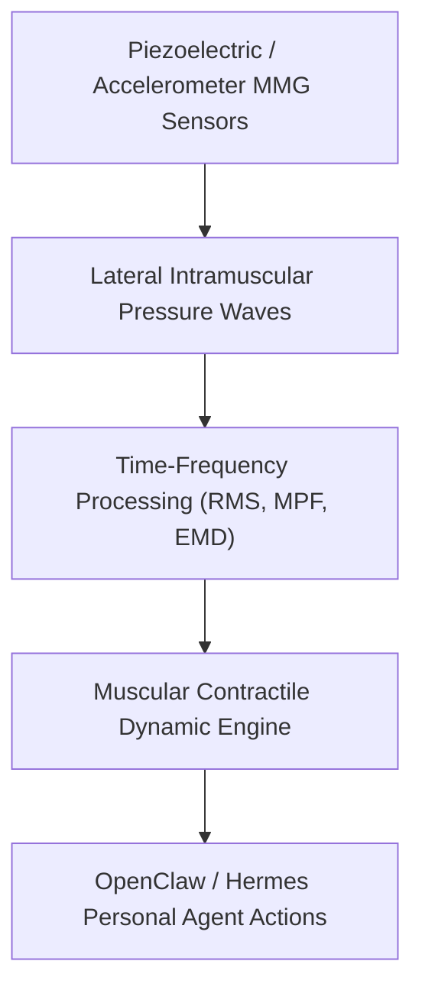

# Muscle Mechanomyography (MMG) & Contractile Stiffness Skill

[](LICENSE)
[](https://www.python.org/)
[](requirements.txt)
[](mcp_server.py)
[](SKILL.md)

Zero-dependency sovereign personal agent skill for non-invasive analysis of Muscle Mechanomyography (MMG), electromechanical delay (EMD), and skeletal muscle fatigue kinetics.



## Features
- **Deterministic Math**: Pure Python standard library implementation with zero external dependencies.
- **Biomechanical Standard Metrics**: Implements validated equations for mechanomyographic amplitude and spectral power frequency.
- **Peripheral Muscular Fatigue Stratification**: Quantitative evaluation of excitation-contraction uncoupling and cross-bridge kinetics.
- **Model Context Protocol (MCP)**: Native JSON-RPC tool integration for LLMs and autonomous agents.

## Quickstart

```python
from client import MuscleMechanomyographyClient

client = MuscleMechanomyographyClient()
result = client.evaluate_mechanomyography(
    mmg_rms_amplitude_mv=1.92,
    mmg_mean_power_frequency_hz=27.4,
    electromechanical_delay_ms=33.5
)
print("Contractile Score:", result["muscular_contractile_score"])
print("Classification:", result["classification"])
```

## License
Apache-2.0
